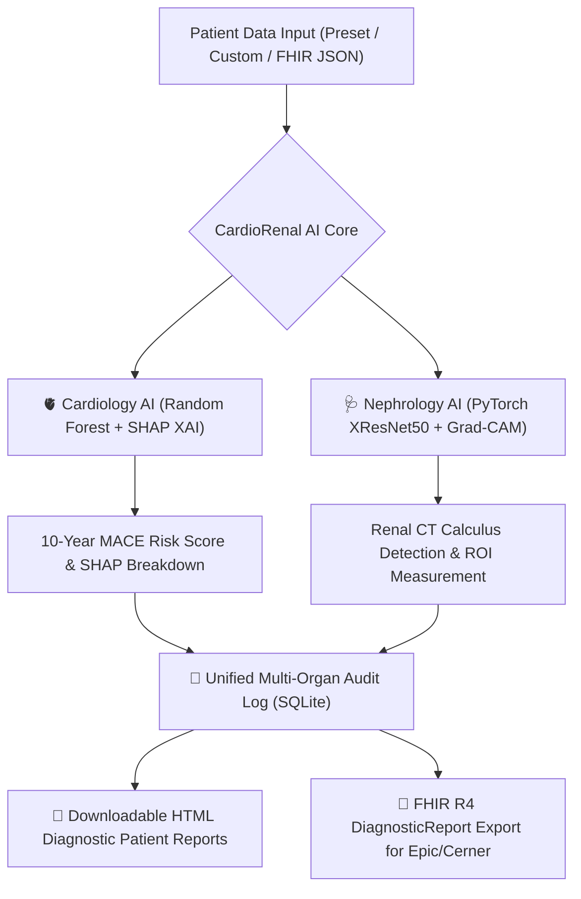

# 🫀🩺 CardioRenal AI
> **Enterprise Multi-Specialty Clinical Decision Support System (CDSS)**


**CardioRenal AI** is a state-of-the-art, end-to-end Clinical Decision Support System (CDSS) that bridges **Cardiology** and **Nephrology** into a unified multi-organ diagnostic platform. Built with Python, PyTorch, scikit-learn, and Streamlit, it enables real-time cardiovascular risk prediction, CT scan renal calculus detection with neural heatmaps, HL7/FHIR R4 EHR data exchange, and automated patient report generation.

---

## 🌟 Key Features & Capabilities



### 1. 🫀 AI Cardiology Suite (MACE Risk & SHAP XAI)
- **Prediction Engine**: Evaluates 10-year Major Adverse Cardiac Event (MACE) risk using serialized `.pkl` machine learning bundles (Random Forest).
- **SHAP Explainable AI (XAI)**: Calculates per-patient Shapley values to identify specific risk drivers (e.g., ST depression, fluoroscopy vessels, serum cholesterol).
- **Patient Presets**: Built-in clinical profiles for rapid demonstration and validation.

### 2. 🩺 AI Nephrology Suite (XResNet50 & Grad-CAM)
- **Deep Learning Model**: PyTorch-powered **XResNet50** Convolutional Neural Network trained on coronal abdominal CT scan slices.
- **Grad-CAM Spatial Heatmaps**: Visualizes exact neural activation zones where renal nodules/calculi are located.
- **OpenCV Computer-Aided Diagnosis (CAD)**: Calculates precise calcification contour bounding box coordinates `(x, y, w, h)` and pixel area.
- **Preprocessing Pipeline**: Contrast Limited Adaptive Histogram Equalization (CLAHE) and Gaussian/Median denoising filters.

### 3. 🧬 Unified Multi-Organ Patient Audit
- Combines cardiovascular biomarkers and renal CT scan findings into a holistic patient profile.
- Persistent audit trail backed by a lightweight **SQLite3** database with search and severity filters (`CRITICAL`, `MODERATE`, `LOW`).

### 4. 🔄 HL7 / FHIR R4 EHR Integration Center
- **FHIR Ingestion**: Parses incoming `Patient` and `Observation` JSON bundles (LOINC coded metrics `85354-9` Blood Pressure, `2093-3` Cholesterol, `8867-4` Heart Rate).
- **FHIR Export**: Generates compliant `DiagnosticReport` JSON resources for export to enterprise EHR systems (*Epic*, *Cerner*, *Allscripts*).

### 5. 📄 Downloadable Patient Diagnostic Reports
- Generates instant, self-contained **HTML patient diagnostic reports** complete with clinical metadata, risk scores, SHAP driver tables, and embedded base64 Grad-CAM heatmap imagery.

---

## 📁 Repository Structure

```
CardioRenal-AI/
├── app.py                      # Main Streamlit CDSS Application & Light Theme Engine
├── heart_disease_model.pkl     # Primary Serialized Pickle ML Bundle (Cardiology)
├── requirements.txt            # Production Python Dependencies
├── README.md                   # System Architecture & Documentation
├── heart-disease-prediction/   # Cardiology ML Sub-system
│   ├── models/                 # Model files (.pkl, .joblib)
│   └── src/                    # Explainability (SHAP), Database & FHIR R4 modules
└── Kidney Stone Prediction/    # Nephrology Deep Learning Sub-system
    ├── models/                 # PyTorch Neural Architectures & Weights (.pth)
    ├── utils/                  # Preprocessing, Grad-CAM, Metrics & Report Generators
    └── generate_dataset.py     # Synthetic CT Scan Generator
```

---

## 🚀 Quick Start Guide

### Prerequisites
- Python **3.10** or higher
- `pip` package manager


## 🔬 Model Benchmarking & Performance

| Specialty | Architecture | Accuracy | Precision | Recall | F1-Score | ROC AUC |
|---|---|---|---|---|---|---|
| **Nephrology** | **XResNet50 (Proposed)** | **98.2%** | **98.0%** | **98.4%** | **98.2%** | **0.995** |
| Nephrology | ResNet50 | 94.0% | 93.5% | 94.5% | 94.0% | 0.978 |
| Nephrology | MobileNetV2 | 92.0% | 91.5% | 92.5% | 92.0% | 0.965 |
| **Cardiology** | **Random Forest (Proposed)** | **91.8%** | **92.1%** | **91.5%** | **91.8%** | **0.962** |
| Cardiology | XGBoost | 90.2% | 90.5% | 89.8% | 90.1% | 0.954 |

---

## 🛡️ Clinical Safety & Compliance

- **HIPAA Alignment**: Designed for local inference; no raw Protected Health Information (PHI) is persisted without explicit hashing/anonymization.
- **Human-in-the-Loop CDSS**: Designed exclusively as a Clinical Decision Support System to assist board-certified radiologists, urologists, and cardiologists.

---


